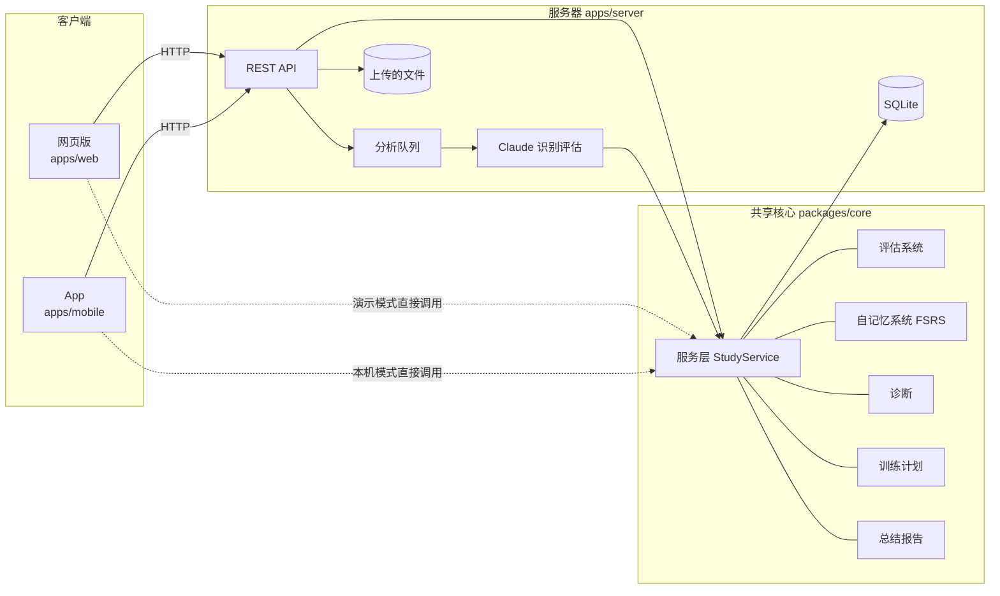
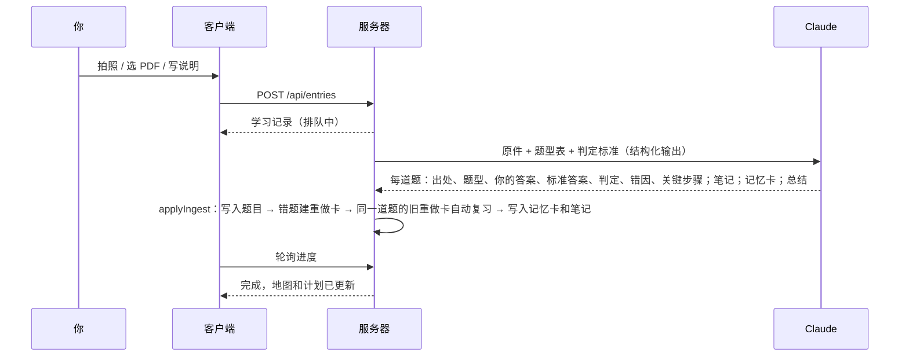

# 体系架构

## 一句话

你每天把学习内容（做题照片、PDF、笔记、一段说明）上传上来，系统自动完成：**识别 → 评估 → 归档 → 总结 → 记忆 → 找薄弱点 → 安排明天的训练**。你不在系统里刷题，题目都在自己的书和本子上做。

## 总体结构



- **共享核心（packages/core）**：所有业务逻辑都在这里，是纯 TypeScript，不依赖存储方式。服务器、网页演示版、App 本机模式用的是同一套代码，所以三个地方算出来的掌握度、计划完全一致。
- **服务器（apps/server）**：负责存储（SQLite）、保存上传的文件、调用 Claude 做识别评估、提供 REST API。网页版构建后也由服务器直接提供，一个端口就够了。
- **网页版（apps/web）**：适合在电脑上看全局，包括能力地图、知识框架图、诊断、报告和卡片管理。
- **App（apps/mobile）**：适合在手机上拍照上传、看今日计划、刷记忆卡。

## 一次上传会经过什么



AI 的判定可以在记录页逐题修改（判定结果、所属题型），修改后掌握度和计划会立刻重算。

## 六个子系统

### 1. 评估系统（`assessment.ts`）

每次作答按结果折算成得分：

| 判定 | 得分 | 含义 |
|---|---|---|
| 正确 | 1.0 | 答案对，过程没有实质错误 |
| 计算失误 | 0.6 | 思路对，算错或漏了最后一步 |
| 未做完 | 0.35 | 写对一部分 |
| 方法错 | 0.15 | 方法选错或不会用 |
| 概念不清 | 0.1 | 定义、定理条件理解错 |
| 空白 | 0 | 没作答 |

每个题型的掌握度用**带遗忘的贝叶斯估计**：

- 每条记录的权重 = 题目类型系数 × 0.5^(距今天数 / 30)，越久远的记录影响越小。
- α = 1 + Σ 权重 × 得分，β = 1 + Σ 权重 × (1 − 得分)，掌握度 = α / (α + β)。
- 有效证据量 Σ 权重决定置信度。只有一次记录时地图上画虚线框，表示证据还少。
- 分界线：≥ 66 掌握，45–66 不稳，< 45 薄弱。

### 2. 自记忆系统（`memory.ts`）

用 FSRS 算法（ts-fsrs 库）安排每张记忆卡的复习时间：

- 评分「忘了 / 模糊 / 记得 / 秒答」决定下次间隔。
- 最长间隔不超过考试日期，保证考前每张卡都复习到。
- 每天有新卡上限和复习上限，几天没刷也不会欠下几百张。
- 卡片有四种：**公式**、**方法**（看到什么特征用什么方法）、**易错**、**重做**。前三种在系统里复习；**重做卡**出现在训练计划里，要求你在本子上重做那道错题并上传，系统根据新的判定**自动**给它评分，形成闭环。

### 3. 收纳整理（`taxonomy.ts`）

数学二分成 11 个章节、49 个题型。每个题型带：

- 考频（★★★ 几乎每年考，★★ 常考，★ 偶尔考）；
- 前置题型（例如「定积分计算」的前置是「不定积分」「有理函数积分」）；
- 标准方法要点。

AI 识别出的每道题都必须归到这 49 个题型里（结构化输出用枚举限定 id），所以所有记录都能落到同一张地图上。

### 4. 诊断（`diagnosis.ts`）

- **薄弱点优先级** = 考频权重 × (1 − 掌握度) × 证据可信度 + 根因加成。
- **根因**：一个题型薄弱，而它的前置题型也薄弱（或是从没测过的常考题型），前置题型就被标为可能的根因；它拖累的题型越多，越该先补。知识框架图里的红线就是这个关系。
- **盲区**：常考但没有任何记录的题型。
- **错因画像**：最近 30 天的错误类型分布，按章节拆开。
- **反复出错**：同一题型在两份以上材料里都做错。

### 5. 培训训练系统（`planner.ts`）

按离考试的天数分阶段：

| 阶段 | 距考试 | 重点 |
|---|---|---|
| 补漏期 | > 60 天 | 按题型逐个补，先补前置 |
| 强化期 | 25–60 天 | 真题和补漏并行，每 4 天至少一套整卷 |
| 冲刺期 | 7–24 天 | 真题套卷为主，错题当天回炉 |
| 考前一周 | ≤ 6 天 | 不学新内容，只过卡片和错题 |

每天的计划由五类任务组成，按优先顺序放进每日时间预算：记忆复习、错题重做、专项补强（如果薄弱题型的前置也薄弱，先补前置）、盲区摸底、真题套卷。

计划生成之后，你上传的内容和复习记录会**自动勾选**对应任务：比如计划里要求补强「极坐标计算」，当天上传了两道这个题型的题，这项就自动完成。

### 6. 总结（`reports.ts`）

- **日报**：上传了什么、做了多少题、对了多少、哪些题型掌握度变化、AI 写的总结和要点。
- **周报**：每天的做题量和正确率、复习量和记住比例、进步和退步的题型、仍然薄弱的题型。

## 数据模型

| 集合 | 说明 |
|---|---|
| entries | 学习记录（一次上传），含处理状态、AI 总结 |
| attachments | 上传的原件 |
| attempts | 每道题的作答记录：出处、题型、你的答案、标准答案、判定、错因 |
| notes | 从笔记里整理出的知识点 |
| cards | 记忆卡及其 FSRS 状态 |
| reviews | 复习记录（可撤销） |
| plans | 每天的训练计划 |

存储通过 `Store` 接口抽象：服务器用 SQLite（`node:sqlite`，不需要额外安装数据库），演示版和 App 本机模式用内存存储加本地持久化。

## AI 部分

- 模型：Claude Opus 5.5（`AI_MODEL` 可改），开启自适应思考，`AI_EFFORT` 默认 high。
- 一次请求完成全部识别评估，输出受 JSON Schema 约束（结构化输出），题型 id 只能从 49 个里选。
- 系统提示词（题型表 + 判定标准）开启了提示缓存。
- 开启了服务端兜底（`fallbacks: "default"`）：主模型拒绝时自动换模型重试。
- 失败会给出具体原因（密钥无效、请求过频、网络不通、文件太大），在记录页可以重试。

## 目录

```
packages/core     共享核心（类型、题型表、评估、记忆、诊断、计划、报告、服务层、API 契约、初始数据、测试）
apps/server       服务器（Hono + SQLite + Claude）
apps/web          网页版（React + Vite）
apps/mobile       App（Expo + React Native）
docs              文档
```
